# Equipment Custody and Stock Control

**Data analysis of the equipment control of a logistics unit (fictional data): asset register, custody records ("cautelas"), equipment use and consumables stock, with PostgreSQL, analytical SQL, Python (pandas/NumPy) and Power BI. Plus a web system for the counter (checkout, return, custody, stock and administration, on desktop and mobile) that writes through the same database rules.**

> Project 2 of my data portfolio, after the [Sales Dashboard](https://github.com/DiegoSantiago1/analise-vendas-concessionaria). **A real project:** I built the equipment custody system of the supply section where I worked in the Brazilian Air Force, which is still in use, and the stock reports presented at meetings with my superiors. This is the version rebuilt for the portfolio, with fictional data.

## 🔗 Access the project

[](https://diegosantiago1.github.io/Portifolio/projetos/controle-materiais/)
[](https://diegosantiago1.github.io/Portifolio/#projetos)

**Direct link:** https://diegosantiago1.github.io/Portifolio/projetos/controle-materiais/

The system runs in the browser on fictional data, with nothing to install. Whatever you do stays in your browser.

[Português](README.pt-BR.md) · The code, tables and screens are in Portuguese; the main terms are translated below.

| Portuguese | English |
|---|---|
| cautela | custody record: who took an item, when it is due back |
| BMP | asset tag number of a single unit |
| retirada / devolução | checkout / return |
| equipamentista | counter operator who hands out equipment |
| carga patrimonial | asset register |
| material de consumo | consumables |

## The problem

I worked in the Brazilian Air Force in administrative roles, including equipment control and asset register checks. In the supply section where I worked, **I built the custody control system, which is still in use**: who took each item, when it must come back and what is in stock. I also put together the reports presented at **meetings with my superiors** to follow the stock. This repository is that work **rebuilt for the portfolio**, with market technologies and **100% fictional data**: nothing from the original system or the organization is here.

The problems such a system solves repeat in any equipment control: the same item written several ways, asset numbers blank or mistyped, equipment the spreadsheet says is in the depot but is on loan to someone, tools that never come back on time, consumables that run out before the purchase arrives.

The project turns that routine into four business questions, answered with data:

1. **Reconciliation:** where does the register spreadsheet disagree with the records, and where do errors concentrate?
2. **Custody:** who has each item, who returns late, and is the delay the person's or the process's?
3. **Use:** what is idle, what is short and what wears out?
4. **Consumables:** which item will run out, and which have a badly set minimum stock?

> **All data is fictional**, generated in Python. No real information (people, units, places, asset numbers) is in this repository, and the project includes no firearms, ammunition or armory equipment (baton, ceremonial sword and sabre appear as riot-control and ceremonial equipment).

## Results

| # | Question | Main result | Detail |
|---|---|---|---|
| A1 | Register reconciliation | 47.8% of the 358 lines have a problem, but 146 are formatting only (fixed automatically); **24 go to human review**. The Central Depot has 15.5% of the lines and **43.9% of the problems**. | [notebook](notebooks/01_conferencia.ipynb) |
| A2 | Custody and delays | Delay is mostly **a process problem**: power tools are late 45% of the time in Maintenance and 5% elsewhere. A naive ranking would blame 5 punctual people; adjusting for the equipment, with a Wilson interval, **no punctual person is flagged** and the 4 planted repeat offenders are found. | [notebook](notebooks/02_cautela.ipynb) |
| A3 | Use and idle stock | 4 types account for 81% of custody records. **R$ 64 thousand sitting idle** in 6 types that never left the shelf all year, while angle grinders, pressure washers, laptops and power tools spent **10 to 57 days with no unit available**. | [notebook](notebooks/03_uso.ipynb) |
| A4 | Consumables and stock-outs | The toner's minimum is **7 times lower** than the reorder point (56 days without toner in the year). The analysis finds the 3 badly set minimums, the slow supplier (38 days against 13) and the 3 overstocked items: **24 of 24 items**. | [notebook](notebooks/04_consumo.ipynb) |

<p align="center">
  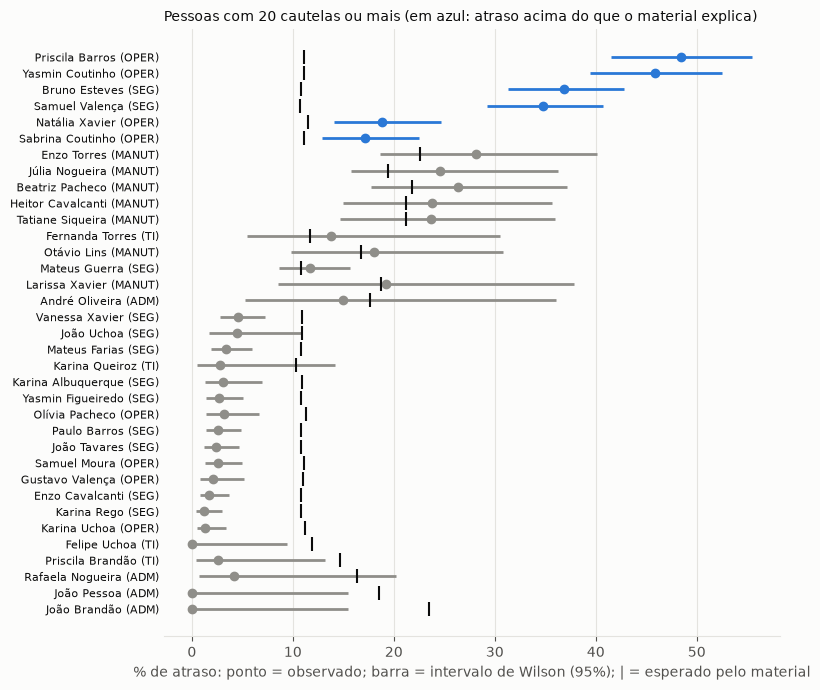
  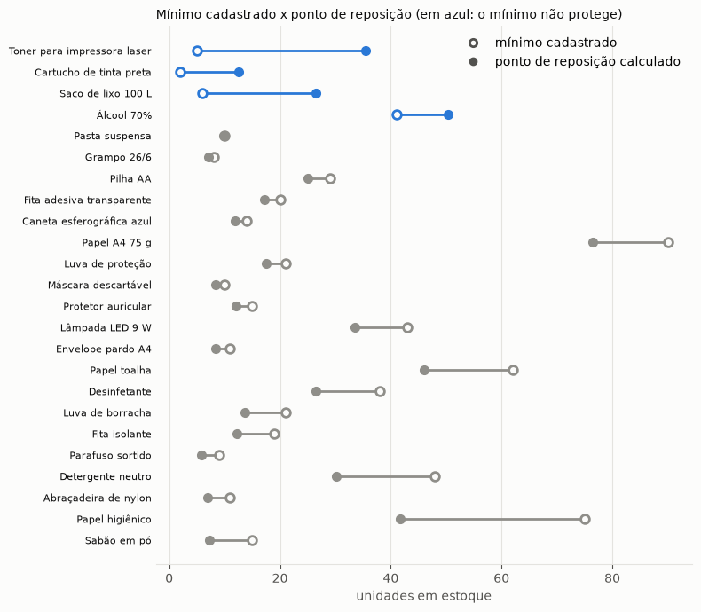
</p>

<p align="center">
  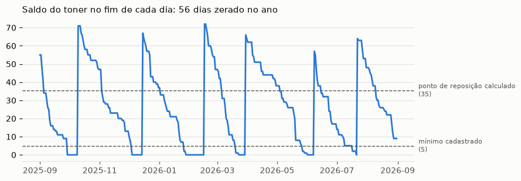
</p>

### How I know the analyses are right

The data was generated with **planted, documented patterns** (see the [PLAN](docs/PLAN.md), P1 to P16) and an **answer key** the analyses never use to conclude, only to check at the end:

- **A1:** the reconciliation caught the 243 errors injected in the standard spreadsheet and, on seven other data sets the rules had never seen (1,750 injected errors), missed **2** and flagged **1** extra.
- **A2:** found the 4 repeat offenders without flagging any punctual person.
- **A4:** 24 of 24 items classified correctly, also on four out-of-sample data sets, with a comfortable margin.

Out-of-sample validation exposed real defects, fixed in the rule and not in the number (details in [DECISOES](docs/DECISOES.md), D14 to D17).

## Architecture

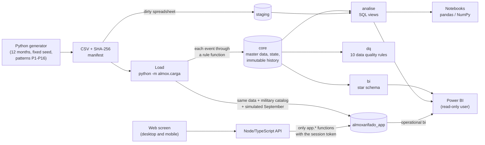

- **`core`:** master data, current state and an **immutable movement history** (INSERT only; triggers block UPDATE, DELETE and TRUNCATE; mistakes are fixed with a reversal). Every movement goes through a **PL/pgSQL function** that checks the role, locks the row (`SELECT ... FOR UPDATE`), validates the rule and writes everything in one transaction.
- **`staging`:** the "dirty" register spreadsheet, as it came, and the answer key of its errors.
- **`analise`:** the four analyses as SQL views (CTEs, window functions, *gaps and islands*, trigram similarity, Levenshtein).
- **`dq`:** data quality, only what constraints cannot enforce (history chaining via `LAG`, state against history, etc.).
- **`bi`:** a star schema for Power BI, read by a **read-only** user that cannot see `core` or `staging` ([guide](docs/POWERBI.md)).
- **`app`:** login and sessions (passwords with `scrypt`, sessions stored only as a hash) and the functions the API may run, all requiring a valid session.

## The application: the supply counter system

At the counter, whoever hands out equipment must record **who took what, how many, who handed it over and when**, in a few taps, and see right away what is overdue. That is usually a notebook or a spreadsheet, exactly where the errors found by the reconciliation (A1) and the delay analysis (A2) come from.

<p align="center">
  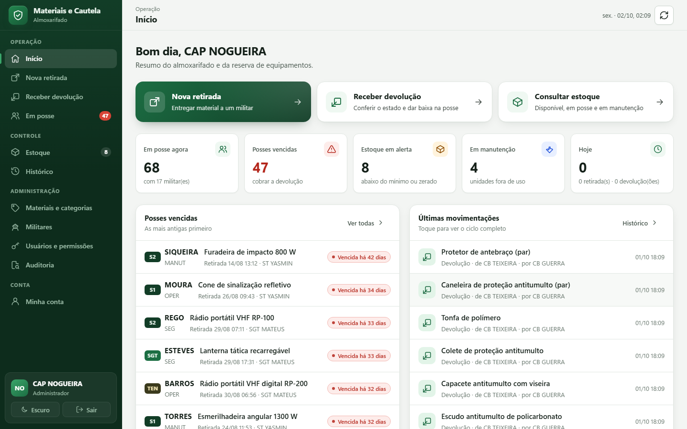
  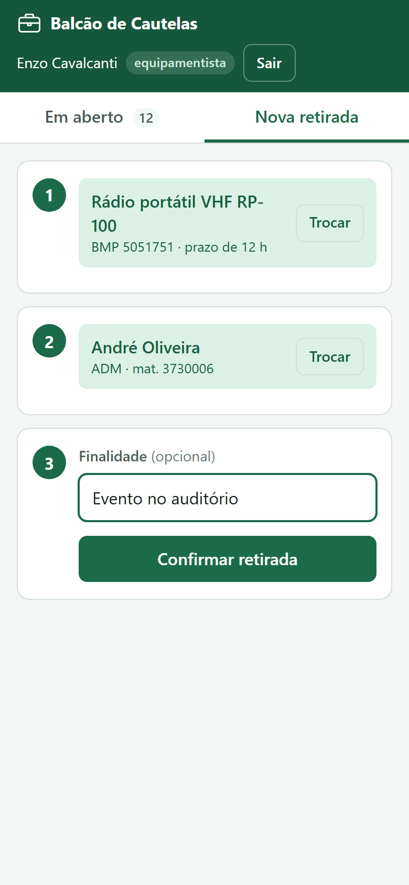
  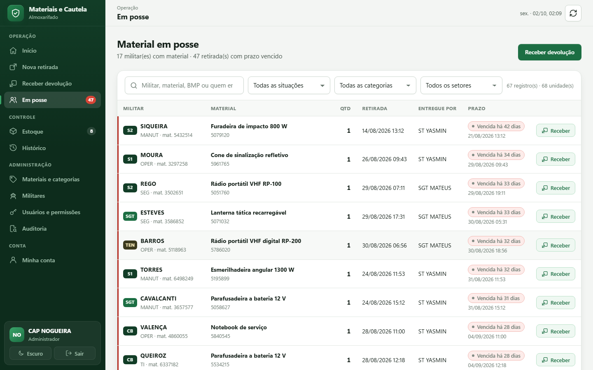
  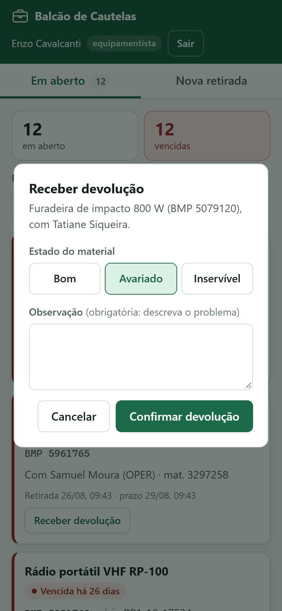
  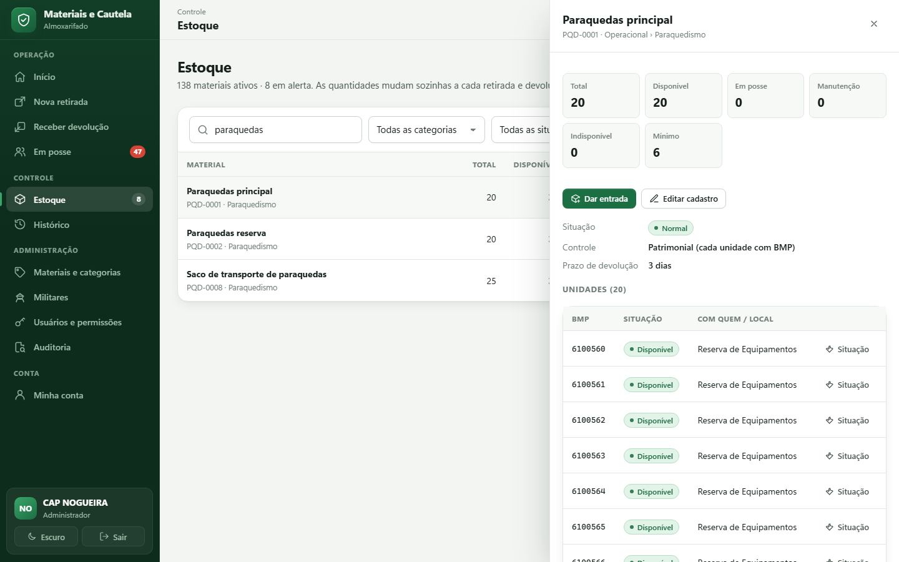
  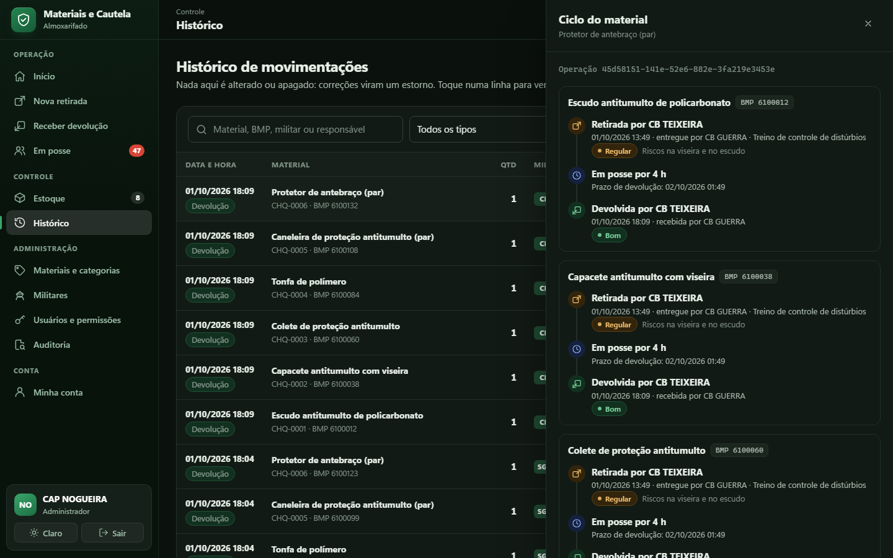
</p>
<p align="center">
  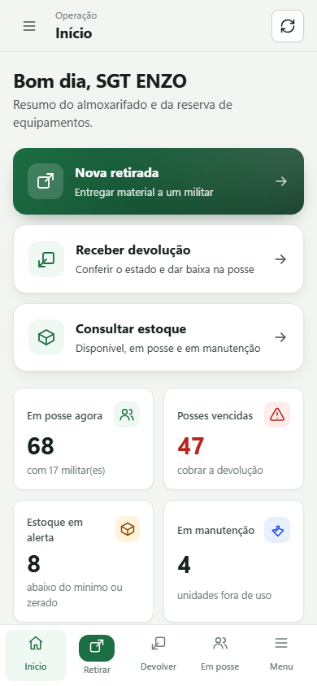
</p>

- **Service members identified by their call name** and rank (private to colonel), which is how the operator looks them up at the counter.
- **New checkout:** the service member, one or more items (by quantity, letting the database choose the units, or by the asset tag), the condition they left in and the purpose. All in one transaction, with an **operation code** tying the units of the same service; a receipt lists asset tags and due dates.
- **Receive a return:** tick the units that came back (it can be part of a checkout) and their condition: damaged goes to maintenance, unusable to write-off. The original checkout stays in the history.
- **In custody:** who has each item, since when, who handed it over and the due date, overdue first, with search and filters.
- **Stock:** total, available, in custody, in maintenance, unavailable and minimum per item, updated on every movement, plus each item's panel with all its units. Negative stock is impossible: the database refuses it.
- **History** with filters and the **cycle** of each service (checkout → custody → return, with who handed over and who received).
- **Administration:** items and categories, service members (registration, editing, leaving the unit), users and permissions (role, activation, password) and an audit trail of every change.
- **No charts on the screen**, on purpose: it is for operating. Analysis lives in Power BI: the [operational report](docs/POWERBI.md) (stock, movements, custody and due dates, operators, service members and maintenance) reads the same database.

<p align="center">
  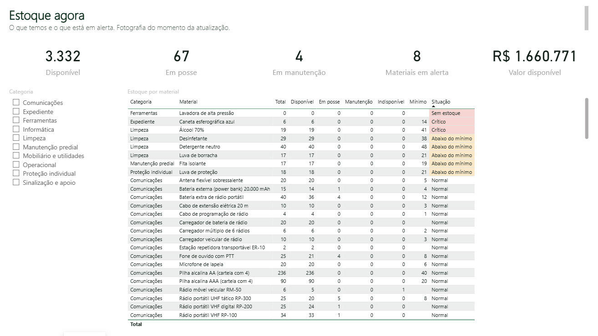
  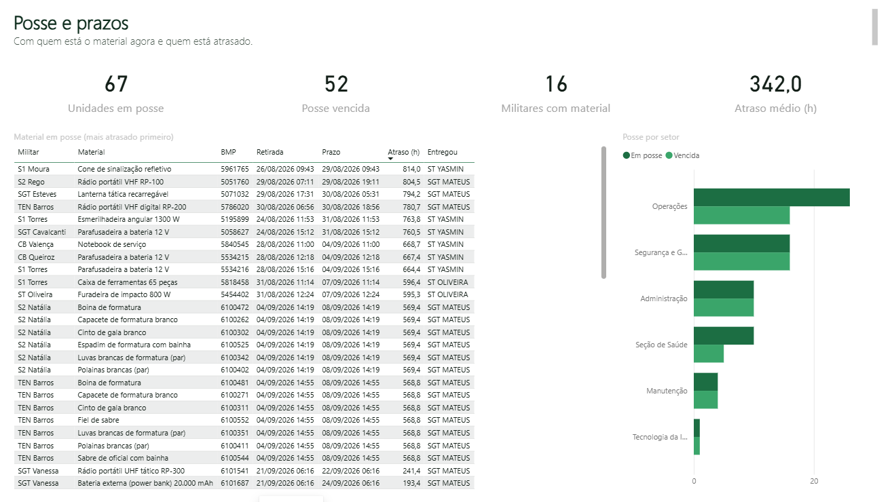
</p>

**Roles:** the **operator** runs the counter (checkout, return, custody, stock, history); the **administrator** has full access; there is also a stock keeper (counter + receipts and adjustments) and a read-only role. The screen hides what the role cannot do, the API answers 403, and finally the database function checks the role again.

**The API rewrites no rule.** It calls the same database functions the load uses, and its user **cannot write to any `core` table**. Since migration 0015 it can only run `app.*` functions, which receive the **hash of the session token** and look up in the database who is logged in (D24): even with SQL injection in the API, nobody acts as an administrator without a logged-in administrator's token.

**Security, tested** (D21): `scrypt` passwords, a session in an `HttpOnly` + `SameSite=Strict` cookie stored only as a hash, login rate limiting, the same answer (and the same time) for an unknown login and a wrong password, CSRF protection (JSON required + origin check), a CSP with no inline script and no data inserted as HTML (tested with an item name containing ``). The application uses **its own database** (D19), with the military catalog and a simulated month of use (D23), so as not to change the analyses' numbers.

## Technical decisions (summary)

Each decision, with context, alternatives and what was measured, is in [docs/DECISOES.md](docs/DECISOES.md) (in Portuguese). Highlights:

- **Business rules in the database (D1).** The generator and the API call the same functions. The load passes each of the 15,751 events through them, which found a defect in the generator itself.
- **`FOR UPDATE` proven, not assumed (D3).** With the lock removed in an experiment, 20 concurrent checkouts corrupted the history: all recorded the same previous balance. With the lock, exactly 10 of 20 succeed on a balance of 10.
- **Integrity in the database (D4).** Composite foreign keys stop mixing tagged assets and consumables; every CHECK has a test that tries to violate it.
- **Person or process, with statistics (D16).** The expected rate comes from the mix of equipment, and a person is flagged only if the lower bound of the Wilson interval is above it.
- **Censored demand (D17).** Days without stock are left out of the demand average; otherwise the items that run out most are the most underestimated.
- **Least privilege for Power BI (D18).** A read-only user with write functions out of reach, including the trap of views calling `SECURITY INVOKER` functions.
- **Quantity without losing the asset tag (D25).** "3 shields" picks 3 units with `FOR UPDATE SKIP LOCKED`: two counters at the same time never get the same unit (tested with 8 concurrent connections), and each unit still goes through the existing rule.
- **The database finds out who is logged in (D24).** Application functions receive the token hash, not a user id, closing the limitation recorded in D20.

## Quality

- **574 Python tests** (`pytest`): schema integrity with hostile input, movement rules, checkout and return by quantity, administration and audit, valid sessions in the application functions, concurrency with real COMMITs, reproducibility of the generator and the simulated activity, patterns P1 to P16, field-by-field fidelity of the load, each data quality rule (injecting the violation), each analysis, and the Power BI and API permissions.
- **134 API tests** (`node:test`, over HTTP, like the browser): login and sessions, brute force, the permission matrix (the operator gets 403 on every administrator route), hostile requests (fake ids, lists with repeats, broken JSON, null characters, huge bodies, SQL injection), CSRF, security headers, rules arriving as HTTP status codes, multi-item checkout as all-or-nothing, and 10 concurrent checkouts of the same unit (exactly one succeeds).
- **A real browser** (Playwright, Chromium, 1440×900 and 390×844): counter and administration flows with no console errors, including XSS and session loss after a role change.
- **CI** (`.github/workflows/ci.yml`) runs ruff, mypy, all Python tests and the API's Biome, `tsc` and tests on every push, against a real PostgreSQL 16 with the same bootstrap and migrations.
- A separate test database, rebuilt by the migrations on every run: up, down and up again, which also tests the *downgrades*.
- `ruff` (lint, formatting and security rules, notebooks included) and `mypy --strict`.
- **Reproducible:** the same seed and end date generate byte-identical files (SHA-256 in the [manifest](data/gerado/manifesto.json)).

## Technologies and why

| Technology | What for |
|---|---|
| PostgreSQL 16 (Docker) | integrity in the database, rule functions, analytical views, the `pg_trgm`, `fuzzystrmatch` and `unaccent` extensions |
| SQL | CTEs, window functions (`LAG`, `LEAD`, running sums, `RANK`), *gaps and islands*, `LATERAL` |
| Python, NumPy, pandas | data generator, Wilson interval, reorder point, evaluation against the answer key, notebooks |
| Alembic | versioned migrations with hand-written SQL (16 migrations) |
| Power BI | operational and analytical reports as versioned PBIP projects (model in TMDL, pages in PBIR) |
| Node 24, TypeScript, Express 5, `pg` | the system's API, with hand-written SQL |
| HTML, CSS, JavaScript | responsive screen, ES modules per page, no framework or build step |
| pytest, ruff, mypy | tests, lint and types (Python) |
| `node:test`, Biome, `tsc` | tests, lint and types (API and screen) |
| GitHub Actions | CI with a real PostgreSQL |

## Run it

Requirements: Python 3.14, Docker Desktop and a PostgreSQL 16 container. This project uses the same container as the [Sales Dashboard](https://github.com/DiegoSantiago1/analise-vendas-concessionaria) (`docker compose up -d` in its folder), with its own databases and users.

```bash
# 1. Python environment
python -m venv .venv
.venv\Scripts\activate            # Windows (Linux/macOS: source .venv/bin/activate)
pip install -r requirements-dev.txt

# 2. Configuration: copy the template and change the passwords
copy .env.example .env            # Linux/macOS: cp .env.example .env

# 3. Create the users and databases in the container (safe to run again)
python -m almox.bootstrap

# 4. Apply the migrations
alembic upgrade head

# 5. Generate the fictional data (seed 42, 12 months up to 31 Aug 2026) in data/gerado/
python -m almox.gerador

# 6. Load it, passing each event through the rule functions (~1 min).
#    --recriar is required: it drops and recreates the schema (history is immutable).
python -m almox.carga --recriar
```

### The system (API and screen)

Extra requirement: Node 24. With steps 1 to 4 done:

```bash
# 7. Application database: the same data, the military catalog and a month of use (~1.5 min)
python -m almox.carga --recriar --banco app

# 8. API dependencies and user passwords (typed, not echoed)
cd api
npm install
npm run definir-senha -- rafaela.01   # ADMINISTRATOR
npm run definir-senha -- enzo.04      # OPERATOR (heitor.09 is READ-ONLY)

# 9. Start the API and the screen at http://127.0.0.1:3334
npm start
```

### The online demo

The [demo](https://diegosantiago1.github.io/Portifolio/projetos/controle-materiais/) is the same screen without a server: `demo/demo-api.js` intercepts the `/api` calls and answers in the browser from a snapshot of the application database, repeating the main rules in simplified form (insufficient stock, unit held by someone else, condition without a note, roles). To rebuild it: `python demo/exportar_dados.py` and `node demo/build.mjs <folder>`.

### The Power BI reports

With the databases loaded (steps 6 and 7): open `powerbi/relatorio_operacional.pbip` or `powerbi/relatorio_analitico.pbip` in Power BI Desktop, click **Refresh now** and use the read-only user from `.env` (`ALMOX_BI_USER`/`ALMOX_BI_PASSWORD`). Details, measures and reference numbers in [docs/POWERBI.md](docs/POWERBI.md).

API tests: `python -m almox.migracoes teste` (once, brings the test database to the current schema), then `npm run verificar` (lint, types and tests).

### Checks

```bash
ruff format --check .             # formatting
ruff check .                      # lint (includes security rules)
mypy                              # types (strict)
pytest                            # all tests (needs the database; ~2 min)
pytest -m "not lento"             # without the full loads
pytest -m "not integracao"        # only tests that do not use the database
```

## Limitations and next steps

- **Application:** reversals from the screen and returns made by someone else on the holder's behalf do not exist yet; reversals are still only through the database function. The login rate limit lives in one process's memory, and the API runs only on `127.0.0.1`, without HTTPS (publishing it would add a TLS proxy and the `Secure` cookie).
- The data patterns were planted. The analyses were validated by finding them again, which shows the method works, but does not replace real data.
